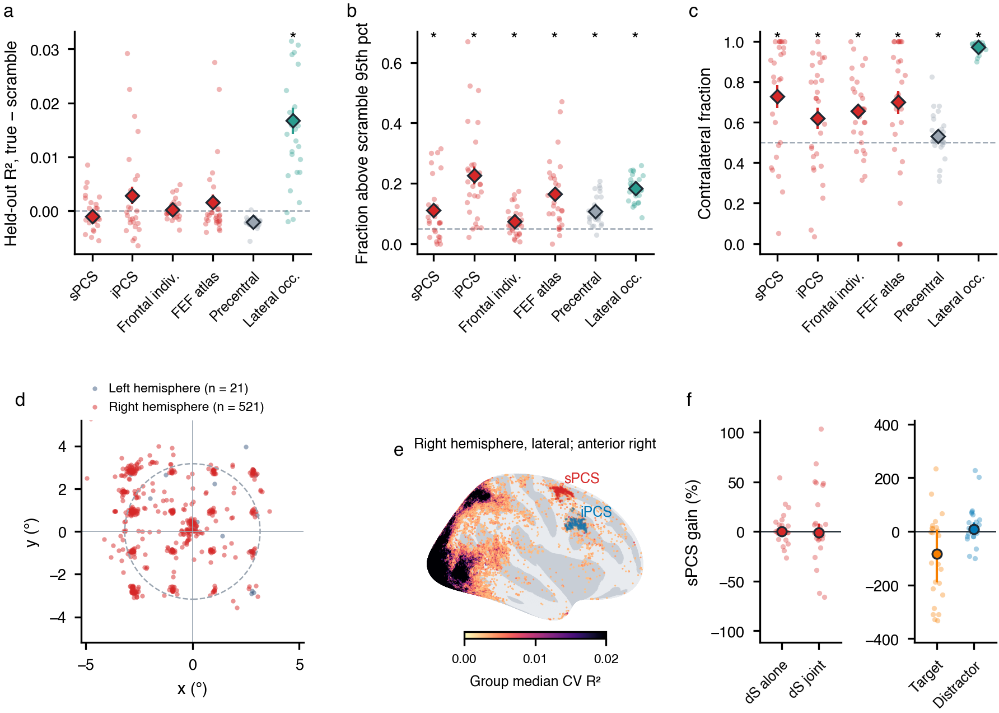

# Side project: does the frontal eye field / superior precentral sulcus have pRFs, and an HP-specific sustained gain?

Branch `side/fef-2026-11` (from `paper-plan-2026-11`), separate from the paper analyses. Code in `retsupp/side_fef/`
(reuses `retsupp/side_hippocampus/` from `side/hippocampus-2026-11`). Derivatives only in `derivatives/side_fef_*`.
n = 28 (sub-03 … sub-30).

**Verdict.**
- **pRFs: weakly.** A functionally defined right sPCS has a small set of voxels with contralateral pRFs. The ROI as
  a whole does not predict held-out data better than a spatially scrambled stimulus.
  - About 8–12 % of voxels beat the scramble null, about 15 per participant.
  - Of those, 82 % (median) lie in the contralateral hemifield; Wilcoxon p = .0004 with the leave-one-out ROI.
    The whole precentral label gives 51 %.
  - The map is almost entirely right-hemisphere at group level.
- **dS: no evidence either way.** The paper's joint gain-field model was fitted with pRFs refitted together with the
  gains. dS in sPCS is −0.13 % estimated alone (95 % CI −1.2 to +3.5 %) and −0.9 % estimated jointly (CI −7.7 to
  +8.0 %); neither differs from 0.
  - The CIs include the paper's pooled visual-cortex values (−1.3 % alone, −3.5 % joint), so this does not show that
    frontal cortex lacks the effect.
  - The Wang-atlas FEF gives the same picture.
  - The frontal fits are poorly constrained: shared terms often sit at their bounds, and the item weight is about 7–20×
    the bar.

## Why a functional ROI

The Wang-atlas FEF label is small (median 87 voxels per participant). At the paper's selection it has almost no
reliable voxels (median 2 at r > 0.1 against a circular-shift null). In the group pRF atlas (`notes/side_prf_atlas/`),
cross-validated pRFs in frontal cortex form two right-hemisphere clusters: one at the junction of the superior
precentral and superior frontal sulci (the classic FEF / sPCS location of Mackey & Curtis), and one in the inferior
precentral sulcus (iPCS).

## Methods

**Group ROIs on fsaverage** (`define_group_roi.py`; `data/fsaverage_rois.npz`).
- Input: the group median over participants of the signed cross-validated pRF R² of the atlas project. A Gaussian pRF
  is fitted to session 1 and tested on session 2, and the reverse; the value is `sign(cv_r)·cv_r²`, unsmoothed.
- Mask: aparc precentral + caudal middle frontal + superior frontal, posterior to y = +15 mm and lateral to |x| = 15 mm.
- Within that mask, take vertices with group CV R² > 0.0025, which is a held-out r of 0.05 in the median participant.
- **sPCS** is the connected clusters of those vertices that touch Destrieux `S_precentral-sup-part`, with at least 5
  vertices. **iPCS** is the same for `S_precentral-inf-part`.
- Size: sPCS has 34 (left) and 539 (right) vertices; iPCS has 5 (left) and 468 (right).

**Leave-one-participant-out (LOSO) versions** (`loso_rois.py`).
- The group map includes the participant being tested, so the ROI would be selected partly on that participant's
  noise.
- So for each participant, the group map and the clusters are recomputed from the other 27. These `sPCSloso` /
  `iPCSloso` ROIs are the ones used for every test and fit below.

**Projection to BOLD space** (`extract_rois.py`).
- Each fsnative vertex takes the label of its nearest fsaverage vertex on `?h.sphere.reg`.
- Each vertex is sampled at 6 depths from the white to the pial surface. Every sample votes for its BOLD voxel, and
  the voxel takes the majority label, so voxels mostly in the opposite bank of a sulcus are excluded.
- Only voxels inside the BOLD mask are kept.
- Median voxels per participant: sPCS 156 (left about 7, right about 150), iPCS 228.

**Per-participant definition** (`sPCSind`): voxels of the projected frontal mask with a cross-validated positive pRF in
that participant's signed fit (circular-shift null p < .05, cv r > 0, amplitude > 0). Median 424 voxels.

**Controls**:
- the Wang-atlas FEF (`FEFatlas`);
- from the hippocampus project (same method, same participants): the whole FreeSurfer precentral label and lateral
  occipital (positive control).

**Map test** (`fit_prf_cv_roi.py`, unchanged from the hippocampus project).
- Folds are the paper's: three folds, each holding out one run of every HP condition.
- On the training runs: a Gaussian pRF, a DoG pRF, and a DoG pRF with one HRF per region. The stimulus is the paper's
  bar + search-item rectangles. Scoring is on the held-out runs.
- Null: the same fits on a pixel-scrambled stimulus. This keeps how much stimulus is on screen in each frame and
  removes where it is.
- Measures, per participant × ROI:
  - median held-out R² (true − scramble);
  - the fraction of voxels above the scramble 95th percentile;
  - the contralateral fraction among those voxels.
- Tests: Wilcoxon, one-sided, BH correction across the four frontal ROIs.
- A cross-check from the atlas project's signed session-split fits is in `data/signed_summary.tsv` (`summarize_signed.py`).

**Gain fields** (`modeling/fit_cv_ladder_nested.py`, unchanged except for an opt-in `--roi-mask-dir`).
- Settings: the paper's all-runs fit (`CV_SCHEME=full`, `BOUNDED`, `MAX_BOLD_SD=20`), models m4_TDS and m7_full with
  their ancestors.
- Polish: `--polish --polish-method alt` (pRFs refitted together with the gains, two rounds).
- Voxels: the paper's model-free selection rule (cross-run reliability r > 0, circular-shift p ≤ .01; `SELECTION_TABLE`).
  - The reliability table comes from the atlas project's whole-brain run of the same statistic
    (`side_fef_selection/`), because the paper's table covers only the atlas ROIs.
  - r > 0.1 would leave a median of 4 sPCS voxels, so r > 0 was used: median 31 voxels in sPCS (10th percentile 7) and
    15 in the FEF atlas label.
- HRF: the participant's **IPS** HRF from the paper's table (`roi_hrf_dog_final2.tsv`).
  - The region-HRF fits in the frontal ROIs were dominated by noise voxels and ran to the dispersion floor (delay
    3.6 s, dispersion 0.15, against 4.3 s and 0.25 in the paper's areas).
- dS estimated alone: `fit_fixed_group_mechanisms --mechanisms dS --overlay-per-model` on the polished m4_TDS, then
  `collect_conditional_estimates`.
- Statistics (`gain_stats.py`): median, bootstrapped 95 % CI of the median (10,000 resamples), k of n, Wilcoxon
  (two-sided).

## Results



`fig_fef.pdf`, 180 mm.
- **a–c**: Map tests per ROI (DoG with region HRF). Dots are participants; diamonds are mean ± SEM; \* marks p < .05,
  one-sided (BH across the frontal ROIs; controls uncorrected).
- **d**: Visual-field centres of the sPCS voxels that beat the scramble null, all participants. The dashed circle is
  the bar aperture.
- **e**: Group CV R² on the inflated right hemisphere, with the group ROIs.
- **f**: Gain-field estimates in sPCS. Dots are participants; markers are the median with bootstrapped 95 % CI.

### Is it a map? (DoG with region HRF; `data/prf_cv_tests_dog_roihrf.tsv`; Gaussian in `..._gauss.tsv`)

| ROI | Median cvR² true − scramble | p | Fraction > scramble 95th pct | p (BH) | Contralateral fraction (median) | p (BH) |
|---|---|---|---|---|---|---|
| sPCS (LOSO) | −0.0013 (11/28 > 0) | .89 | 0.08 (19/28) | .005 | **0.82** (18/26) | **.0008** |
| iPCS (LOSO) | −0.0001 (14/28) | .89 | 0.20 (26/28) | < .001 | 0.71 (17/28) | .020 |
| Frontal, per participant | −0.0003 (13/28) | .89 | 0.06 (18/28) | .016 | 0.66 (21/28) | .0005 |
| FEF (Wang atlas) | −0.0010 (8/28) | .89 | 0.13 (24/28) | < .001 | 0.74 (21/27) | .002 |
| Precentral, whole label | −0.0020 (1/28) | 1.0 | 0.09 (27/28) | < .001 | 0.51 (19/28) | .038 (unc.) |
| Lateral occipital | +0.015 (25/28) | < .001 | 0.18 (28/28) | < .001 | 0.98 (28/28) | < .001 |

Reading:

- **Held-out R² does not beat the scramble in any frontal ROI.** The median voxel has no pRF. These ROIs mostly
  contain voxels without one, and the few that have one do not move the median.
- **The fraction of voxels above the scramble null is not specific.** The whole precentral label also has 9 % above
  the null, against 5 % expected. Its pRF centres are not contralateral, so that excess is task-locked, not
  retinotopic, as the hippocampus project found. So 8 % in sPCS is no more than baseline.
- **The contralateral bias is the retinotopic signature.** It survives the leave-one-out ROI, and it is absent in the
  rest of precentral cortex.
  - sPCS (LOSO): median 0.82, mean 0.73, n = 26 with any voxel above the null. The Gaussian pRF gives 0.92
    (p = .0001).
  - Signed session-split fits agree: 64 % contralateral, p = .03, about 10 voxels per participant.
  - This rests on few voxels. The signed fits put 452 of the 464 pooled sPCS voxels in the right hemisphere, so the
    evidence is for a right-hemisphere map of the left visual field.
- **No orderly eccentricity or polar-angle map can be shown at this voxel count.**
  - pRF centres fall mostly at the four search-item locations (±2.8°, ±2.8°) and at fixation (panel d), not spread
    over the visual field.
  - Fold-to-fold agreement of x is r ≈ 0.27–0.60 (LO: 0.99). In the signed fits, the session-1 and session-2 centres
    agree on the side of x in 57 % of voxels (LO: 84 %).
  - With the item weight at 7–20× the bar in the gain fits, the frontal pRFs mainly code where the **search items**
    are, contralaterally, rather than following the bar sweep.
- The per-participant definition (reliable CV pRFs anywhere in the generous frontal mask) is dominated by noise.
  Its pass rate is 6.5 % against about 4 % chance, and in the signed fits only 52 % of its voxels are contralateral.
  So a functional definition per participant is not workable here; the group (LOSO) definition is the usable one.

### Gain fields in sPCS (LOSO) and the atlas FEF (`data/gain_stats.tsv`; polished fits, n = 28)

| Term (%) | sPCS median [95 % CI] | k/n | p | FEF atlas median [95 % CI] | k/n | p |
|---|---|---|---|---|---|---|
| dS, estimated alone | −0.13 [−1.19, 3.52] | 16/28 | .99 | −0.06 [−1.24, 1.60] | 17/28 | .78 |
| dS, joint (m7_full) | −0.85 [−7.70, 7.97] | 15/28 | .88 | −0.84 [−5.44, 17.9] | 15/28 | .60 |
| g_HP, joint | +5.9 [−15.1, 22.1] | 16/28 | .97 | +9.9 [−20.4, 25.7] | 18/28 | .67 |
| g_LP, joint | +4.2 [−8.1, 16.7] | 15/28 | .58 | +8.5 [−13.7, 21.6] | 18/28 | .85 |
| Target, joint | −84 [−191, +6] | 18/28 | .026 | −175 [−208, −89] | 22/28 | .001 |
| Distractor, joint | +8.9 [−6.3, 34.1] | 18/28 | .23 | +4.1 [−10.8, 10.6] | 16/28 | .54 |
| Items (weight × 100) | 725 [337, 2900] | 28/28 | < .001 | 2158 [858, 3250] | 28/28 | < .001 |

Median voxels per fit: sPCS 31, FEF atlas 15. Reference, from the paper's polished fits pooled over nine visual areas:
dS alone −1.3 %, dS joint −3.5 %, target +17 %, distractor +8 %.

Reading:

- **dS: null, but not informative.** The CI on dS estimated alone (about −1 to +3.5 %) covers 0 and also the size of
  the visual-cortex effect. The joint CI is about ±8 %.
- **The frontal fits are poorly constrained.**
  - Shared terms often sit at their bounds: σ_dyn at 8° in a quarter (sPCS) to half (FEF atlas) of the participants, transient gains at ±10 in
    several.
  - The item weight is very large.
  - The target gain is negative, which is the opposite sign from visual cortex. Read it as a side effect of the large
    item weight: a smaller response at the target relative to the other items. It is not a robust frontal effect.
  - These estimates come from about 30 voxels whose pRFs are themselves weak.
- **Decoding** the bar (`decode/decode_final.py`) was not run. With about 30 voxels (as few as 5–7 in some
  participants) and pRFs that mostly sit at item locations rather than following the bar, a bar decode would not say
  anything.

## Outputs

`notes/side_fef/data/`:
- `fsaverage_rois.npz`
- `signed_summary.tsv`, `signed_voxels.tsv.gz` (signed session-split CV pRFs per ROI)
- `prf_cv_summary.tsv`, `prf_cv_voxels_prf.tsv.gz`, `prf_cv_tests_{gauss,dog,dog_roihrf}.tsv` (map tests)
- `roi_hrf_side_fef.tsv` (region HRFs from the CV fits, not used), `roi_hrf_ipshrf.tsv` (the HRF used)
- `gain_fits_shared.tsv`, `gain_fits_prf_shift.tsv`, `dS_alone.tsv`, `gain_stats.tsv`, `gain_wide.tsv`

Cluster derivatives (`/shares/zne.uzh/gdehol/ds-retsupp/derivatives/`):
- `side_fef_rois/` (BOLD-space masks: float32, 1 = left, 2 = right, scl_slope cleared)
- `side_fef_region_ts/`, `side_fef_selection/`, `side_fef_prf_cv/`, `side_fef_hrf/`
- `side_fef_ladder_full_bounded_maxsd20_relnull_r0_ipshrf{,_polished}/`
- `side_fef_fixed_mech_dS/`

The sPCS / iPCS group ROIs that include the tested participant (`sPCS`, `iPCS`) were projected and are in
`side_fef_rois/`. Their CV fits were cancelled in favour of the LOSO versions; only a few finished.

## Reproduce

```bash
# local: group ROIs
python -m retsupp.side_fef.define_group_roi --sums /data/ds-retsupp/derivatives/side_prf_atlas_group/group_sums_fsaverage_v3.npz \
    --fsaverage /data/ds-retsupp/derivatives/fmriprep/sourcedata/freesurfer/fsaverage --out notes/side_fef/data/fsaverage_rois.npz
# cluster, clone ~/retsupp_side_fef on this branch
sbatch --array=3-30 retsupp/side_fef/slurm_jobs/extract_rois.sh                 # 2 min, 16 GB per participant
LOSO=1 sbatch --array=3-30 retsupp/side_fef/slurm_jobs/extract_rois.sh
for R in sPCSloso iPCSloso sPCSind FEFatlas; do for V in true scramble; do
  REGION=$R VARIANT=$V sbatch --array=3-30 retsupp/side_fef/slurm_jobs/fit_prf_cv_roi.sh; done; done   # sPCSind: --time=04:00:00
python -m retsupp.side_fef.summarize_signed --voxels-out ... --summary-out ...  # compute node
python -m retsupp.side_fef.collect_prf_cv --voxels-out ... --summary-out ... --hrf-out ... --prf-voxels-out ...
D=/shares/zne.uzh/gdehol/ds-retsupp/derivatives
CV_SCHEME=full BOUNDED=1 MAX_BOLD_SD=20 SELECTION_TABLE=$D/side_fef_selection MIN_R=0 MAX_P=0.01 \
  ROI_MASK_DIR=$D/side_fef_rois HRF_TABLE=$D/side_fef_hrf/roi_hrf_ipshrf.tsv POLISH=1 POLISH_METHOD=alt \
  POLISH_MODELS="m4_TDS m7_full" MODELS="m4_TDS m7_full" ROI_LIST="sPCSloso FEFatlas" \
  OUTPUT_ROOT=$D/side_fef_ladder_full_bounded_maxsd20_relnull_r0_ipshrf \
  sbatch --mem=14G --time=02:00:00 --array=5-60 retsupp/modeling/slurm_jobs/fit_cv_ladder_nested.sh
R=side_fef_ladder_full_bounded_maxsd20_relnull_r0_ipshrf
ROIS="sPCSloso FEFatlas" BASE_ROOT=$R OVERLAY_ROOT=${R}_polished OVERLAY_PER_MODEL=1 MECHANISMS=dS \
  HRF_TABLE=$D/side_fef_hrf/roi_hrf_ipshrf.tsv OUTPUT_SUBDIR=side_fef_fixed_mech_dS \
  sbatch --array=3-30 retsupp/modeling/slurm_jobs/fit_fixed_group_mechanisms.sh
python -m retsupp.visualize.paper.collect_polished_fits --root $R --subjects $(seq 3 30) --out ~/side_fef/gain_fits
python -m retsupp.visualize.paper.collect_conditional_estimates --bids-folder /shares/zne.uzh/gdehol/ds-retsupp \
    --folder side_fef_fixed_mech_dS --out ~/side_fef/dS_alone.tsv
# local
python -m retsupp.side_fef.gain_stats --shared notes/side_fef/data/gain_fits_shared.tsv --cond notes/side_fef/data/dS_alone.tsv \
    --out notes/side_fef/data/gain_stats.tsv --wide-out notes/side_fef/data/gain_wide.tsv
python -m retsupp.side_fef.plot_fef --summary notes/side_fef/data/prf_cv_summary.tsv --voxels notes/side_fef/data/prf_cv_voxels_prf.tsv.gz \
    --fsaverage /data/ds-retsupp/derivatives/fmriprep/sourcedata/freesurfer/fsaverage \
    --sums /data/ds-retsupp/derivatives/side_prf_atlas_group/group_sums_fsaverage_v3.npz --gain-wide notes/side_fef/data/gain_wide.tsv
```

**Resources** (standard partition, CPU).
- CV pRF fits: 4 CPUs, 12 GB, 10–60 min per participant × ROI × variant. One iPCS task needed 3 h.
- Gain-field fits: 4 CPUs, peak 9.5–14.7 GB, about 33 min per participant × ROI. Two tasks needed a resubmit with
  24 GB, which resumed from checkpoints.
- Total about 640 allocated vCPU-hours, including cancelled tasks.
