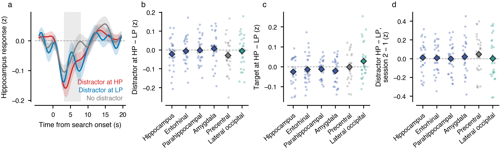

# Side project: do hippocampal / MTL voxels have pRFs?

Branch `side/hippocampus-2026-11`, separate from the paper analyses. Derivatives only in
`derivatives/side_hpc_*`; code in `retsupp/side_hippocampus/`.

**Verdict (pRFs): no pRF signal in hippocampus, entorhinal, parahippocampal cortex or amygdala.** Held-out pRF predictions
are no better than a spatially scrambled stimulus in any participant. The fraction of voxels beating the scramble
null is at chance (5 %), and those voxels show no contralateral bias. The positive control (lateral occipital
cortex) passes every test by a wide margin, so the method can find pRFs. Step 1 is clearly null, so step 2 (gain
fields, HP − LP sustained gain) was not run: without a pRF there is nothing for a gain field to modulate. Any null
HP gain there would be uninterpretable rather than exciting.

**Verdict (region-level HP test, no pRFs): the MTL deactivates after every search display, and more so with a
distractor present, but it does not distinguish HP from LP distractors or targets, and no HP − LP difference appears
with learning** (see the follow-up section below).

## Question

Statistical learning is often placed in the hippocampus / MTL. Do MTL voxels have pRFs in this paradigm (bar sweep +
search array), and if so, do they carry an HP-specific gain field?

## Data and regions

n = 28 participants (sub-03 … sub-30), 2 sessions × 5–6 runs, cleaned BOLD (258 volumes). Regions from FreeSurfer
`aparc+aseg`, resampled (nearest neighbour) to BOLD space, inside the BOLD mask: hippocampus (17/53), entorhinal
(1006/2006), parahippocampal (1016/2016), amygdala (18/54). Controls: lateral occipital (1011/2011, positive) and
precentral (1024/2024, negative). Median voxels per participant: hippocampus 1371, parahippocampal 710, amygdala 537,
entorhinal 461. The controls were subsampled at random to 1500 voxels.

## Methods (step 1)

- **Cross-validated pRFs** (`fit_prf_cv_region.py`). These are the paper's folds: fold k holds out the k-th run of
  every HP condition, so there are 3 folds of ~8 training and ~4 test runs. On the training runs only:
  1. a Gaussian pRF, canonical HRF (grid + GD);
  2. a DoG pRF seeded from 1;
  3. a DoG pRF with one HRF per region, fitted jointly with the pRFs (`fit_roi` / `flex_factory` of
     `modeling/cv/fit_prf_cv_roi_hrf_joint.py`, unchanged).

  The stimulus is the paper's bar + search-item rectangles, resolution 50, radius 5°, with sd_min = 0.2.
  Held-out R² (cvR²) per voxel = 1 − ΣSSE/ΣSST over the three test sets. The baseline is the test-run mean, so
  cvR² > 0 means the prediction is better than a flat line.
- **Null: spatial scramble.** The same fits, on a stimulus whose pixels are permuted by one fixed random permutation
  per participant. Frame by frame this keeps how much stimulus is on screen (bar and search-array onsets). Any
  response locked to the task or to "stimulus present" can still be fitted, but where the stimulus is gets lost. So
  cvR² above scramble requires visual-field-specific (retinotopic) structure. This addresses the concern from the
  quick check: the repeating, task-locked response in hippocampus that precentral cortex shows even more strongly.
- **Per participant × region:**
  - Δ = median cvR² (true) − median cvR² (scramble).
  - "pRF voxels": true cvR² above the 95th percentile of that participant's and region's scramble cvR². Expected
    fraction 5 % without retinotopic signal.
  - Among pRF voxels, the fraction with the centre in the contralateral hemifield.
- **Group tests:** n = 28, Wilcoxon signed-rank, exact, one-sided in the direction a pRF predicts. Benjamini-Hochberg
  across the four MTL regions. The controls are reported uncorrected.
- Numbers below are for the DoG with region HRF. The Gaussian and the DoG with canonical HRF give the same picture
  (`data/prf_cv_summary.tsv`, column `model`).

## Results


`fig_prf_evidence_dog_roihrf.pdf`, 180 mm. **a**, Held-out R², true − scramble. **b**, Fraction of voxels above the
scramble 95th percentile; the dashed line is the 5 % expected by chance. **c**, Contralateral fraction among those
voxels. Dots: participants. Diamonds: mean ± SEM. \*: p < .05, one-sided (BH across the four MTL regions).

| Region | cvR² true | cvR² scramble | Δ (true − scramble) | Participants Δ > 0 | p (BH) | Fraction > scramble 95th pct | p (BH) | Contralateral | p (BH) |
|---|---|---|---|---|---|---|---|---|---|
| Hippocampus | −0.004 | −0.001 | −0.0026 ± 0.0001 | 0 / 28 | 1.0 | 0.039 ± 0.002 | 1.0 | 0.51 ± 0.02 | .41 |
| Entorhinal | −0.003 | −0.001 | −0.0024 ± 0.0001 | 0 / 28 | 1.0 | 0.042 ± 0.002 | 1.0 | 0.49 ± 0.03 | .65 |
| Parahippocampal | −0.003 | −0.001 | −0.0026 ± 0.0001 | 0 / 28 | 1.0 | 0.047 ± 0.003 | 1.0 | 0.50 ± 0.03 | .41 |
| Amygdala | −0.004 | −0.001 | −0.0025 ± 0.0001 | 0 / 28 | 1.0 | 0.035 ± 0.002 | 1.0 | 0.53 ± 0.03 | .41 |
| Precentral (neg.) | −0.003 | −0.000 | −0.0021 ± 0.0002 | 1 / 28 | 1.0 (unc.) | 0.108 ± 0.009 | 3.7 × 10⁻⁸ (unc.) | 0.53 ± 0.02 | .038 (unc.) |
| Lateral occipital (pos.) | 0.036 | 0.019 | +0.017 ± 0.002 | 25 / 28 | 9.3 × 10⁻⁸ (unc.) | 0.183 ± 0.008 | 3.7 × 10⁻⁹ (unc.) | 0.97 ± 0.004 | 3.7 × 10⁻⁹ (unc.) |

cvR² columns: mean over participants of the median over voxels. ± is SEM over participants. Full table with exact p:
`data/prf_cv_tests_dog_roihrf.tsv`.

Reading:

- **MTL: no pRFs.** Median held-out R² is below zero in every region and below the scramble fits in all 28
  participants. The true-stimulus pRF has more freedom to fit noise in the training runs, and it pays for that on
  the test runs. Only 4–5 % of voxels beat the scramble 95th percentile, which is chance or slightly below. Those
  voxels sit at 50 % contralateral, as they would if their centres were noise.
- **Lateral occipital**: about twice the scramble cvR². 18 % of voxels beat the null and 97 % of those are
  contralateral. Fold-to-fold pRF positions agree at r ≈ 0.99. The pipeline detects real pRFs.
- **Precentral** has 11 % of voxels above the scramble null, with a weak contralateral tendency (53 %, p = .038
  uncorrected). That fits a small retinotopic patch, plausibly the frontal eye field in the precentral sulcus. The
  MTL regions show nothing similar.
- Fold-to-fold agreement of pRF x is above the scramble in every region, including the negative control
  (`d_xagree` in the test table). The folds share half their training runs, and the bar stimulus constrains noise
  fits differently from the scrambled one, so this measure does not tell signal from noise here. It is left out of
  the figure.
- This agrees with the earlier quick check. MTL has a tiny repeating response, but precentral shows more of it, and
  whole-brain pRF centres show no contralateral bias. The response is task-locked, not tied to the visual field.

## Step 2 (gain fields): not run

The plan gated step 2 on a pRF signal in step 1. The gain-field model (pRFs + T/D/S gain fields, m4_TDS / m7_full)
only says something where a voxel's response depends on stimulus position. In the MTL it would fit noise, and a null
dS would carry no information.

## Follow-up: region-level HP test without pRFs

**Verdict: the MTL responds to the search displays but not to the HP regularity.** All four MTL regions deactivate
after every search display, and hippocampus, parahippocampal cortex and amygdala deactivate more when a distractor is
present. The responses do not depend on whether the distractor or the target is at the HP location, and no HP − LP
difference emerges over sessions or over the runs of a block. Meanwhile behaviour shows that the regularity was
learned: RTs are 15 ms faster with the distractor at HP.

**Methods** (`export_region_mean_ts.py` on a compute node, then `deconvolve_region_events.py` and
`stats_region_events.py` locally, since nideconv is not in the cluster env):

- **Signal.** Mean cleaned BOLD over all voxels of each anatomical region, both hemispheres, z-scored within run. The
  masks are anatomical and nothing is selected on the data, so nothing is circular.
- **Events.** Every search display (target onset) is one event, labelled by the distractor (at the run's HP
  location / at an LP location / absent) × the target (HP / LP). The target never shares the distractor's location,
  so there are five types: dHP_tLP, dLP_tHP, dLP_tLP, dabs_tHP, dabs_tLP. Per run of 60 trials: 30, 12, 6, 3 and 9.
- **Deconvolution.** As in `visualize/paper/deconvolve_location_responses.py`: nideconv, Fourier basis with 13
  regressors, −4 to 20 s, one intercept per run, OLS.
- **Sustained regressor.** A block-level sustained HP regressor is not estimable here: the HP location is fixed
  within a run, so such a regressor is collinear with the run intercepts.
- **Readout.** Mean response 3.2–8 s after onset. Measures:
  - amplitude: mean of the five types;
  - dD = distractor at HP − at LP, with the target at LP in both;
  - dT = target at HP − at LP, averaged over distractor at LP and absent;
  - capture = distractor present − absent, with the target at LP.
- **Learning.** dD and dT re-estimated on session 1 vs session 2 runs, and on the first vs the third run of each HP
  block.
- **Tests.** n = 28, Wilcoxon signed-rank, exact, two-sided (there is no directional prediction for the MTL). BH
  across the four MTL regions per measure; controls uncorrected.
- **Motor / eye-movement confounds.** The precentral control covers the motor side. The analysis was also re-run
  with a trial-wise RT regressor (an extra event on every trial whose amplitude is the RT, z-scored within run), which
  removes anything that only follows response time.



`fig_region_hp_test.pdf`, 180 mm. **a**, Hippocampus, deconvolved response to search displays with the target at LP;
the distractor at HP, at LP or absent. Bands are ± SEM over participants; grey marks the readout window. **b**,
Distractor at HP − at LP. **c**, Target at HP − at LP. **d**, Distractor HP − LP difference, session 2 − session 1.
Dots: participants. Diamonds: mean ± SEM.

| Region | Amplitude (z) | p (BH) | dD distractor HP − LP | p (BH) | dT target HP − LP | p (BH) | Capture (present − absent) | p (BH) |
|---|---|---|---|---|---|---|---|---|
| Hippocampus | −0.085 ± 0.022 | .0009 | −0.022 ± 0.015 | .81 | −0.026 ± 0.013 | .29 | −0.042 ± 0.012 | .003 |
| Entorhinal | −0.068 ± 0.015 | < .0001 | −0.005 ± 0.013 | .90 | −0.014 ± 0.014 | .29 | −0.015 ± 0.013 | .31 |
| Parahippocampal | −0.083 ± 0.019 | .0003 | −0.002 ± 0.013 | .90 | −0.012 ± 0.009 | .29 | −0.040 ± 0.015 | .003 |
| Amygdala | −0.113 ± 0.021 | < .0001 | +0.008 ± 0.016 | .85 | −0.021 ± 0.012 | .29 | −0.045 ± 0.013 | .003 |
| Precentral (unc.) | +0.144 ± 0.026 | < .0001 | −0.029 ± 0.016 | .063 | −0.002 ± 0.013 | .88 | −0.005 ± 0.015 | .76 |
| Lateral occipital (unc.) | +0.308 ± 0.032 | < .0001 | −0.005 ± 0.016 | .88 | +0.029 ± 0.017 | .26 | −0.005 ± 0.017 | .58 |

Values are mean ± SEM (z). Full table, including the learning tests and the RT-regressor variant:
`data/region_event_tests.tsv`.

Reading:

- **The MTL is engaged by the task.** Every MTL region deactivates after search displays (all p < .001), opposite in
  sign to precentral and lateral occipital cortex. With a distractor present, the deactivation in hippocampus,
  parahippocampal cortex and amygdala is about 0.04 z deeper (BH p = .003). This is not motor: precentral shows no
  such effect, and the effect survives the RT regressor (BH p = .02).
- **No HP specificity.** Distractor at HP vs LP: hippocampus −0.022 z, 95 % CI [−0.053, 0.009]; the other regions are
  within ±0.03 z. The CI includes the hippocampal capture effect only at its edge. Target at HP vs LP: all four MTL
  regions have small negative means but BH p = .29. Adding the RT regressor changes nothing (dD BH p ≥ .66, dT BH
  p ≥ .42).
- **No learning.** Neither dD nor dT changes from session 1 to 2 or from the first to the third run of a block (all
  MTL BH p ≥ .27). The closest is hippocampal dT, session 2 − 1 = +0.058 ± 0.029 (uncorrected p = .066, BH p = .27).
- **Behaviour.** RT is 885 ms with the distractor at HP vs 900 ms at LP (−15 ± 5 ms, p = .003). The regularity is
  learned, so the absence of an MTL HP difference is not because there was nothing to learn.
- **Sensitivity caveat.** Region-mean responses would also miss the paper's HP-specific effect in lateral occipital
  cortex: it is a gain at the HP location, and averaging over the whole region and both hemifields washes it out. So
  this test asks whether the region *as a whole* responds differently to HP events, not whether a retinotopic sub-part
  of it does. For the MTL, which has no pRFs (step 1), the region-level question is the only one available.

## Reproduce

```bash
# cluster, clone ~/retsupp_side_hpc on this branch
sbatch --array=3-30 retsupp/side_hippocampus/slurm_jobs/extract_region_ts.sh        # -> derivatives/side_hpc_region_ts
for R in hippocampus entorhinal parahippocampal amygdala lateral_occipital precentral; do for V in true scramble; do
  REGION=$R VARIANT=$V sbatch --array=3-30 retsupp/side_hippocampus/slurm_jobs/fit_prf_cv_region.sh; done; done
srun ... python -m retsupp.side_hippocampus.collect_prf_cv --voxels-out ~/side_hpc/prf_cv_voxels.tsv.gz \
    --summary-out ~/side_hpc/prf_cv_summary.tsv                                        # compute node
# region-level HP test
srun ... python -m retsupp.side_hippocampus.export_region_mean_ts   # -> derivatives/side_hpc_region_mean_ts (rsync to /data/ds-retsupp)
python -m retsupp.side_hippocampus.deconvolve_region_events   # local (nideconv)
python -m retsupp.side_hippocampus.stats_region_events
# local
python -m retsupp.side_hippocampus.plot_prf_cv --summary notes/side_hippocampus/data/prf_cv_summary.tsv \
    --out-dir notes/side_hippocampus
```

Resources: extraction 2 CPUs, 24 GB, ~2 min per participant. pRF fits 8 CPUs, 16 GB, 25–90 min per participant ×
region × variant; two large-region tasks needed 24 GB / 5 h. In total about 2,500 vCPU-hours, roughly 5 CHF.
